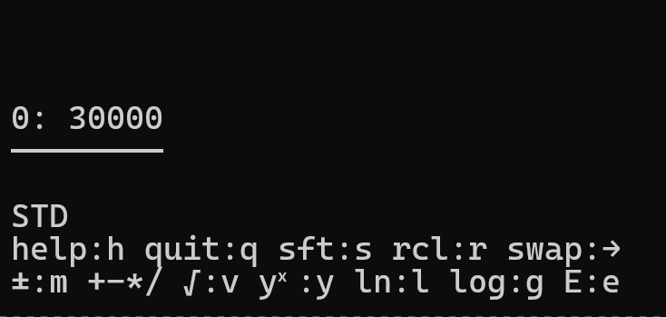
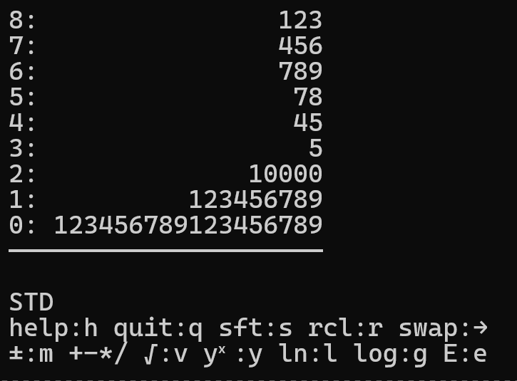

<p>
  
  
</p>

# trpn - RPN calculator for the terminal

## Introduction

**trpn** is a simple, fast-to-use and compact RPN TUI calculator. It draws inspiration from the legendary HP 48 series.

Accuracy got special care: it can be relied on, even in edge cases.

Some features:

- Decimal arithmetic: 28 significant digits stored, up to 20 shown.
- Correctly rounded functions (√x, yˣ, ˣ√y, ln, log, eˣ, 10ˣ): each result is the exact value,
  rounded once.
- A 100-level stack, built-in help (`h`).
- trpn adapts to the available space dynamically when the terminal is resized and/or its font size is increased.
Stack values automatically switch to scientific notation when there's not enough space. Entry is cut with `…` when too long.
- Expected to run in any modern terminal, including through SSH.

This project is currently in its first version; more features are planned.

*Colors and other visual helpers are on the way.*

## How to use it

If you're reading this, you probably already know how RPN works: operands THEN operator.  
Example: `7` `ENTER` `3` `+` gives `10`.

### The essentials

`q` **quits** the app.  
`h` displays **help**.  
`m` toggles the **minus** `-` sign of the number being typed, or of its exponent after `e`.  
`e` starts the exponent, in **E** notation.  
`s` enters **Shift** mode, where more functions are available. Press `s` again to cancel it.  
`r` enters **Recall** mode, then press a digit `1-9` to move the corresponding number back to level `0`. You can also prefix it with `0` to reach levels `10-99` (e.g. `r` `0` `2` `3`).  
`→` **swaps** levels 0 and 1.  
`ENTER` with no entry under way **duplicates** level 0.  
`BACKSPACE` with no entry under way  **drops** level 0.

## Try it

With [uv](https://docs.astral.sh/uv/) installed, nothing else is needed: uv fetches trpn, its
dependencies, and Python if it's missing.

```bash
uvx --from git+https://github.com/ytrebouta/trpn trpn
```

To install it as a command:

```bash
uv tool install git+https://github.com/ytrebouta/trpn
trpn
```

## Dependencies

trpn draws its panes with [Maupertuis](https://github.com/ytrebouta/maupertuis), installed from
GitHub along with it, and reads the keyboard with [blessed](https://github.com/jquast/blessed).

## Documentation

Detailed documentation is being written; a link will appear here.

## License

MIT, see [LICENSE](LICENSE).
